# Referenzdokumentation für Agents

Relative Pfade wie `scripts/…` und `assets/…` beziehen sich auf das Verzeichnis dieses Skills.

Leser ist ein Agent, der in einer späteren Sitzung ohne Vorwissen am Projekt arbeitet.
Er soll nach einem Read wissen, wo was liegt, was wovon abhängt und was er beim Ändern beachten muss.
Am wertvollsten ist, was im Code nicht steht oder nur mühsam zu finden ist: Invarianten, Verträge mit anderer Software, Begründungen, gemessene Werte, Fallstricke.
Was ein Agent mit einer Suche nach einem Namen sofort findet, braucht keine Wiederholung.
Dokumentiert wird nur der Endzustand. Bei Änderungen werden der alte Zustand und der Grund, warum die Änderung erfolgte, nicht erwähnt, wenn sie keine Relevanz für den Endzustand haben.
Das hält die Referenz klein: Der Agent arbeitet mit dem Code, wie er jetzt ist, und die Historie steht in `git log`.

## Aufteilung in Dateien

Eine Datei je eigenständigem Produkt: ein Teil, der für sich läuft und gebaut wird, etwa eine Datenpipeline und eine Web-App im selben Repository.
Bei einem Produkt heißt sie `REFERENCE.md`, bei mehreren `REFERENCE.<teil>.md`, z. B. `REFERENCE.scripts.md` und `REFERENCE.webapp.md`.
Ein Agent liest dann nur das Produkt, an dem er arbeitet, und jede Datei passt eher in einen Read.
Wo sich die Produkte berühren (Dateiformat, API, gemeinsame Konfiguration), beschreibt jede Datei die Schnittstelle aus ihrer Sicht und nennt die andere Datei.

## Ablauf

1. **Bestand:** Gibt es schon eine Referenz, sie ganz lesen und mit `git log` seit ihrer letzten Änderung prüfen, was sich am Code geändert hat. Bei einer Aktualisierung nur die betroffenen Abschnitte und Diagramme anpassen.
2. **Struktur erfassen:** Eine Gliederung mit Signaturen, Konstanten und den ersten Zeilen der Doc-Kommentare ersetzt das Lesen jeder Datei. Die Ausgabe in den Scratchpad schreiben.
   - **Python:** `python scripts/outline.py <ordner oder datei> -o <scratchpad>/outline.txt` liefert Konstanten mit Wert, Klassen, Attribute (auch `self.x`), Signaturen und die erste Docstring-Zeile.
   - **JavaScript/TypeScript:** Der Compiler schreibt eine Gliederung als Deklarationsdateien (Signaturen, JSDoc, exportierte Konstanten mit Wert): `npx tsc -p <tsconfig> --declaration --emitDeclarationOnly --noEmit false --rootDir <quellordner> --outDir <scratchpad>/dts`, für JavaScript zusätzlich `--allowJs`. `--noEmit false` braucht es, weil z. B. Vite-Projekte `noEmit` setzen; `--rootDir` verlangt TypeScript ab Version 6. Ein eigenes Skript über die Compiler-API wäre zerbrechlich: TypeScript 7 hat die klassische JS-API nicht mehr. Nicht Exportiertes fehlt in den `.d.ts`; das findet Grep (z. B. `^(const|function) `).
   - **.NET (C#):** `dotnet run scripts/outline.cs -- <ordner oder datei> > <scratchpad>/outline.txt` liest die Quelltexte mit Roslyn, ohne Build, und liefert Typen mit Primärkonstruktor und Basistypen, Konstanten und `static readonly` mit Wert, Properties, Konstruktoren, Methoden (auch private) und den ersten Satz von `<summary>`. Braucht das .NET-10-SDK; der erste Lauf lädt das Roslyn-Paket von NuGet.
   - **Andere Sprachen:** Deklarationen mit Grep suchen oder die Werkzeuge des Compilers nutzen.
3. **Das Nicht-Offensichtliche lesen:** Kommentare, Fehlerbehandlung, Reihenfolgen, magische Zahlen, Stellen, an denen zwei Dateien denselben Wert kennen müssen. Fakten, die nur der Nutzer kennt (Messungen, Gründe für Entscheidungen), erfragen und mit „(per user)“ kennzeichnen.
4. **Diagramme entwerfen**, dann **den Text schreiben** (Aufbau siehe unten).
5. **Rendern und prüfen:** `python scripts/render_diagrams.py <REFERENCE…md> docs --png-dir <scratchpad>/diagrams` erzeugt je Diagramm `docs/<name>.svg` und zum Ansehen eine PNG im Scratchpad. Die PNGs kurz ansehen: Layoutfehler wie verschachtelte Pakete oder einzeln stehende Klassen sieht man nur im Bild.
6. **Größe messen** (siehe *Größe*).
7. **CLAUDE.md anbieten** (siehe unten).

Das Rendern schickt den Diagrammtext an kroki.io. Bei Code, der das Haus nicht verlassen darf, vorher fragen und einen lokalen Server nehmen: `docker run -d -p 8000:8000 yuzutech/kroki`, dann `--server http://localhost:8000`.

## Diagramme

Diagramme stehen als PlantUML-Text direkt in der Referenz, nicht als Bild.
Der Text ist etwa halb so teuer wie das gerenderte PNG (≈ 700 statt ≈ 1500 Tokens), verlustfrei, durchsuchbar und kommt mit demselben Read; ein Bild in Markdown sieht der Agent nur, wenn er es eigens öffnet.
Für Menschen ist der Quelltext schwer lesbar. Über jedem Block steht deshalb das gerenderte Bild, eingebettet als SVG:

````markdown

```plantuml
@startuml pipeline
...
@enduml
```



````

Der Agent sieht vom Bild nur diese Zeile; der Alt-Text sagt ihm, dass er die Datei nicht öffnen muss.
SVG statt PNG, weil das Bild nur Menschen lesen: Es bleibt in jeder Zoomstufe scharf, und die Datei ist kleiner.
`@startuml <name>` ist Pflicht: Der Name wird zum Dateinamen des Bildes.

### Welche Diagrammart wofür

| Inhalt | Diagrammart |
| --- | --- |
| Datenfluss zwischen Programmen über Dateien, Ordner und externe Dienste | Komponentendiagramm: `component` für Programme, `artifact` für Dateien, `folder`, `cloud` für externe Dienste, `node` für Server oder Plattformen |
| Klassen und ihre Abhängigkeiten | Klassendiagramm, Pakete nach Aufgabe |
| Ablauf mit Bedingungen, z. B. ein Orchestrierungsskript | Aktivitätsdiagramm (`if`/`else`, `note right`) |
| UI-Komponenten, Hooks, Services | Klassendiagramm mit Stereotypen `<<component>>`, `<<hook>>`, `<<module>>` |
| Nachrichten zwischen mehreren Beteiligten, bei denen die Reihenfolge zählt (Protokoll, Handshake) | Sequenzdiagramm, nur wenn es kaum Verzweigungen gibt |
| Objekt mit ausdrücklichen Zuständen | Zustandsdiagramm |

Bei einer Pipeline zeigt das Komponentendiagramm mehr als ein Klassendiagramm: Ihre Skripte reden über Dateien miteinander, nicht über Objekte.
Ein Ablauf, der bisher als eingerückter Aufrufbaum im Text stand, wird zum Aktivitätsdiagramm.

### Inhalt

- Jede Klasse bzw. Komponente bekommt im Körper einen Satz, was sie tut, auf zwei Zeilen umbrochen. Keine runden Klammern im Körper: PlantUML setzt eine solche Zeile als Methode in ein eigenes Fach.
- Kanten sind beschriftet mit dem, was fließt oder aufgerufen wird (`write_manifest()`, `PER_STEP`, `subprocess`).
- Pfeile im Klassendiagramm: durchgezogen = hält eine Instanz (Konstruktor), gestrichelt = erzeugt oder ruft auf, Dreieck = erbt. Im Komponentendiagramm durchgezogen = Daten vom Schreiber zur Datei und von der Datei zum Leser, gestrichelt = Aufruf. Die Legende steht einmal am Anfang des Diagrammabschnitts.
- Stereotypen: `<<script>>` für Kommandozeilenprogramme, `<<module>>` für Dateien nur mit Funktionen und Konstanten, `<<dataclass>>`.
- Ein Element, das ein anderes Diagramm beschreibt, steht nur mit Namen und einem D-Symbol da: `class ForecastGrib << (D,#fdebd1) grib >>`, wobei `grib` der Name jenes Diagramms ist. Namen statt Nummern, damit Verweise beim Umsortieren stimmen.
- Höchstens etwa 20 Elemente je Diagramm, aufgeteilt nach Aufgabe (Download, Datenzugriff, Rendern, App). Größere Diagramme legt Graphviz breit und unübersichtlich an; als Bild werden sie für einen Leser zu klein.
- Reine Konstantenmodule nicht einzeichnen, sondern unter der Legende nennen.

### Layout

Die Blöcke in der Referenz enthalten kein `skinparam`: Der Agent braucht kein Layout, und `render_diagrams.py` setzt es aus `assets/plantuml-style.iuml` beim Rendern ein.
So bleibt das Layout aller Diagramme einheitlich und an einer Stelle änderbar.
Tipps für ein kompaktes Bild:

- `ModelSurface -[hidden]-> T850Climate` stapelt ein Paket unter ein anderes, wenn Graphviz sie nebeneinander legt.
- Im Komponentendiagramm Ordner nach Flussrichtung teilen (Eingaben oberhalb des Programms, Ausgaben darunter) statt einen Ordner mit allem; das hält den Fluss senkrecht.
- Ein Rahmen (`node`) um fast alles macht das Bild breiter; einen Titel (`title`) nehmen.
- Pfeile auf einen Ordner sind erlaubt (`data_dir --> synop`) und ersetzen viele Einzelpfeile.
- `left to right direction` hilft selten; erst ausprobieren.

## Aufbau einer Referenz

Eine neue Referenz auf Englisch schreiben, auch wenn der Nutzer Deutsch spricht: Englischer Text braucht deutlich weniger Tokens.
Eine bestehende Referenz in ihrer Sprache weiterführen; eine Mischung zweier Sprachen in einer Datei liest sich schlechter, als die Ersparnis bringt.
Die UI-Sprache des Produkts und Zitate bleiben, wie sie sind.

1. **Titel und Kopf** (4–6 Zeilen): Umfang, Verweis auf andere `REFERENCE.<teil>.md`, Konventionen (Pfade relativ zum Repository, Einheiten, Zeitzone, Sprachen), „Read the diagrams first“.
2. **Purpose:** Stichpunkte, was das Produkt tut.
3. **Diagrams:** Legende, dann die Blöcke.
4. **Contracts and file formats:** alles, was eine Grenze überschreitet: Dateiformate (mit kurzem Beispiel), Konfiguration, Verträge mit anderer Software, Ordnerlayout mit Schreiber und Inhalt.
5. **Command line** bzw. Einstiegspunkte, Abhängigkeiten (Pakete, externe Programme).
6. **API**, gruppiert wie die Diagramme, je Modul oder Klasse:
   - **Intro:** was nicht in der Signatur steht. Invarianten, Reihenfolgen, Fallstricke dieser Klasse, Gründe, Messwerte. Wenige Sätze.
   - **Field Summary:** Konstanten und Attribute mit Wert und Bedeutung, als Tabelle.
   - **Method Summary:** Signatur (gekürzt) und ein Satz, als Tabelle. Triviale Methoden weglassen, gleichartige zusammenfassen (z. B. eine Zeile für alle Zeichenmethoden eines Produktregisters).
7. **Errors:** Tabelle Situation → Verhalten, nur Fälle, die man dem Code nicht leicht ansieht.
8. **Pitfalls:** nur, was keiner einzelnen Klasse gehört, z. B. Werte, die an mehreren Stellen synchron bleiben müssen.
9. **Extension recipes:** typische Änderungen mit allen Stellen, die mitgezogen werden müssen.

Beispiel eines API-Abschnitts:

```markdown
### ForecastWriter (forecast_writer.py)

Only the main process writes, in `pool.map` order, so the file is byte-identical to a run without pool; switching to `imap_unordered` breaks this.

| Field | Meaning |
| --- | --- |
| `MAX_WORKERS = 8` | 15.8 ms/message with 8, 14.3 with 20 (per user): beyond 8 the writing main process limits |

| Method | Summary |
| --- | --- |
| `write(raw_files, target, expected) -> int` | crop all into `target`, add thickness, a placeholder per expected field without message |
```

### Keine Zeilennummern

Symbole werden mit Datei und Namen genannt (`maps_manifest.py`, `chart_frames`), nicht mit Zeilennummern.
Eine Suche nach dem Namen findet die Stelle sofort; Zeilennummern veralten dagegen mit jeder Änderung über ihnen und führen dann in die Irre, und sie nachzupflegen kostet bei jeder Änderung Aufwand.

## Größe

Ziel: höchstens 25 000 Tokens je Datei, damit sie mit einem Read gelesen wird.
Messen statt schätzen: Die Datei ganz mit dem Read-Tool öffnen. Ist sie größer, bricht Read ab und nennt die Tokenzahl; ist sie kleiner, passt sie.
Faustregeln unterschätzen: Dichte Tabellen mit Code und Zahlen kommen auf nur ≈ 2,2 Zeichen je Token.
Ist eine Datei zu groß: zuerst nach Produkten teilen; dann kürzen, was eine Suche schnell findet (lange Konstantentabellen, Signaturen ohne Mehrwert). Die nicht ableitbaren Fakten bleiben.
Ist eine einzelne Produktreferenz trotzdem größer, ist das in Ordnung: Der Agent liest sie in zwei Teilen.

## CLAUDE.md

Am Ende fragen, ob eine `CLAUDE.md` im Projekt angelegt oder ergänzt werden soll.
Sie sorgt dafür, dass spätere Sitzungen die Referenz lesen und nach Änderungen nachziehen; ohne diesen Hinweis veraltet die Referenz still.
Bei Änderungen an der Referenz soll die Sitzung den Skill document-software laden, damit sie die Prinzipien der Referenzerstellung beachtet.

Eine vorhandene CLAUDE.md nur ergänzen, nicht ersetzen, und die Änderung vorher zeigen.
